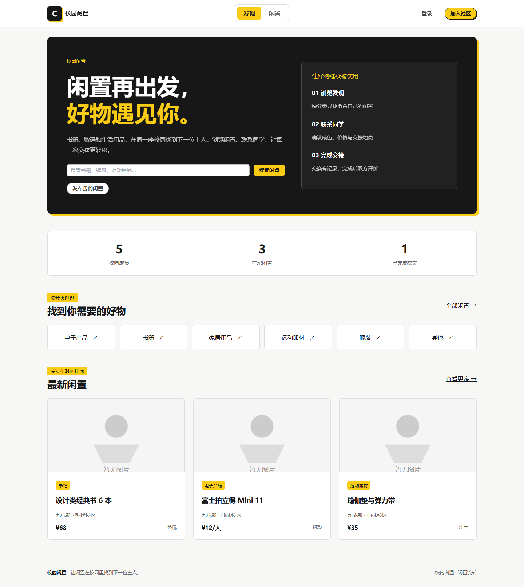

# 校园闲置交易平台 · Campus Loop

基于原 Campus Loop 项目精简为校园闲置交易平台。主要导航只有“发现”和“闲置”，保留账号、个人中心、消息、交易及评价。

## 使用方式

线上完整部署（Vercel Services + Neon）参见 [部署说明](docs/VERCEL_DEPLOYMENT.md)。
本地启动方式保持不变；线上新数据库不会自动导入本地账号和商品。

Windows 双击项目根目录的 `启动.bat`。优先使用 `D:\Node.js\node.exe`，后端使用项目内 `.venv`。
以窗口显示的 `Frontend:` 地址为准；3000 被占用时自动选择后续可用端口。
保持启动窗口开启，Ctrl+C 停止本窗口启动的服务。启动日志在 `logs/startup-*.log`。
启动器检查新版后端标识，避免误用仍在运行的旧版 API。

- 发现：搜索、分类入口、最新在架闲置及实际平台统计。
- 闲置：搜索、分类、成色筛选、排序、发布、详情与编辑。
- 个人中心：资料、密码和“我的闲置”入口。
- 消息：联系同学、会话及未读状态。
- 交易：已有闲置订单查询、交换申请、接受／拒绝、取消与完成。
- 评价：完成交易后评价，以及评价编辑、删除和回复。

延续原项目能力：物品可以标注出售、租赁或交换；当前在线创建订单入口为交换申请，出售和租赁通过联系物主协商。原有出售／租赁订单仍可查询和处理。本次未新增支付或购买／租赁下单系统。

## 页面预览

界面采用黑白亮黄主题：亮黄主操作按钮和选中导航、黑色首页主视觉、白色卡片与浅灰背景。主题变量位于 `frontend/src/styles/index.scss` 和 `variables.scss`，错误与危险操作保留语义警示色。

2026-10-24 主题修改前备份：相邻目录 `../campus-loop-theme-20261024-115424/frontend-source.zip`。恢复时将压缩包中的 `src` 放回 `frontend/src`，将 `README.md` 放回项目根目录；覆盖前先保存后续修改。此次仅调整前端样式，数据库及模型配置未修改。



## 安装与验证

技术栈：Python / Flask / SQLAlchemy / SQLite，Vue 3 / Vite / Element Plus。
本机已配置 Python 虚拟环境及 npm 依赖。迁移到其他机器时：

1. 创建 Python 虚拟环境，安装 `requirements.txt`。
2. 从 `.env.example` 创建 `.env`，配置数据库。
3. 运行 `python init_db.py`。
4. 在 frontend 目录执行 `npm ci`，不要混用其他包管理器。
5. 启动后端 `python run.py`，前端 `npm run dev`；本机也可用双击启动器。

验证命令（项目根目录）：

```powershell
.\.venv\Scripts\python.exe -m unittest discover -s tests -v
& 'D:\Node.js\node.exe' launcher.js --check-startup
cd frontend
& 'D:\Node.js\npm.cmd' run build
```

初始化脚本仅为空数据库写入演示数据，不会重建现有数据库。空数据库的演示账号：
`linan@example.com`、`suyue@example.com`，密码均为 `demo123`。

## 数据兼容

技能和需求专用前端页面、组件、API 客户端及后端路由已删除，旧页面显示“页面不存在”，旧 API 返回 404。
原数据库的 skill、demand 表及关联字段保留用于历史兼容，不再提供业务入口。
旧模块交易、关联评价及带旧模块引用的消息不在当前列表、统计、未读数和操作接口中出现。
用户、闲置商品和闲置订单原样保留；普通私信及闲置关联消息继续可用。
新演示数据只创建闲置业务记录；旧表为空，仅保留结构。初始化兼容升级可重复执行。

## 验证范围与限制

- 后端测试：账号、权限隔离、闲置发布／编辑／检索、交换全流程、消息、评价、旧路由停用、历史数据隔离、新库初始化与旧字段兼容。
- 浏览器：Chrome，桌面 1440px 与手机 390px；检查发现搜索、登录、编辑保存、发布提交、个人中心、消息、交易、评价、我的闲置及旧路由。
- 关键交易状态与越权行为由 API 自动测试覆盖，不声称所有流程都已手工点击。
- 手机布局为浏览器模拟视口，未进行实体手机及所有浏览器测试。
- 已存在的 npm / Node 弃用警告不影响本次通过的检查。
- 本地演示保留原 JWT 内存注销机制、图片 Base64／URL 存储和 Flask 开发服务器；本次未改为生产部署架构。

源码备份、数据保护与具体改动参见 [修改与恢复说明](MODIFICATION_NOTES.md)。

## 智能分类（实验性）

发布和编辑页面支持“智能推荐分类”：只填写商品标题，点击按钮后展示最多三个分类及依据，点击候选才改变表单分类；仍需正常提交才保存。描述选填，保留展示和搜索，不参与分类。
采用九类共 900 个主词的模糊匹配与本地 mDeBERTa 辅助排序；词表由 Agent 根据通用商品知识整理，未经真实词频统计。模型不可用时，明确匹配可返回标注来源的词库建议；其余情况可手动选择。不训练、不上传标题、不新增类别。
本机已安装可选推理依赖并准备模型；首次推理需要加载，网站启动不依赖模型。
当前算法、评估、词库维护及恢复方法见 [混合分类说明](docs/HYBRID_CLASSIFICATION.md)。迁移机器的模型准备方法及旧版结果见 [历史智能分类说明](docs/SMART_CLASSIFICATION.md)。
更新后重启现有启动入口，健康能力标记为 `category-suggestion-hybrid-v3`，使用窗口显示的 Frontend 地址，不固定使用 3000。
真实场景准确率尚未验证，不能把当前合成样本结果当作正式效果承诺。

## 来源

基于 AgentQu / Campus Loop 修改，保留原 [MIT License](LICENSE) 与作者信息。
